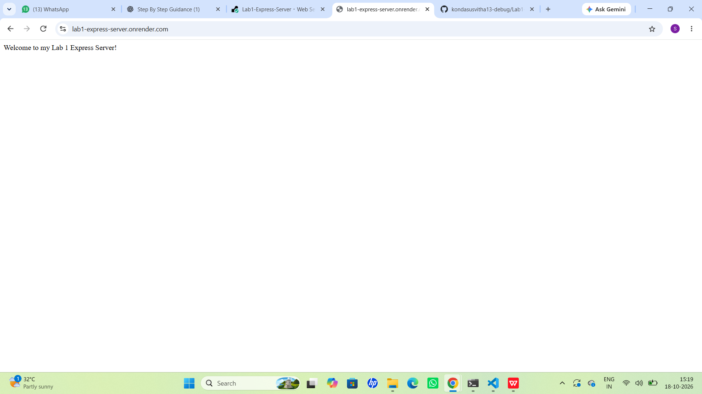
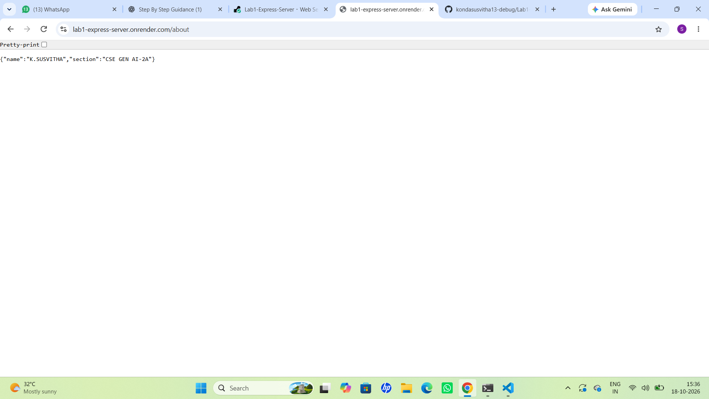
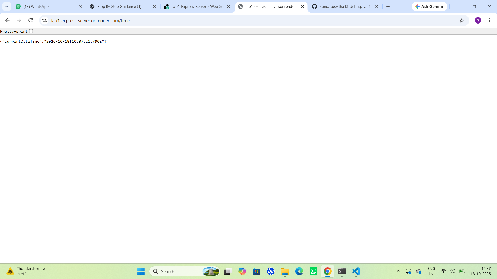

# Lab 1: Node.js and Express Server

**Subject:** Backend Development Fundamentals  
**Year/Term:** Year II, Term II  
**University:** Aurora Deemed to be University

## Student Details

| Field | Details |
|---|---|
| Name | K. Susvitha |
| Section | CSE - GEN AI - 2A |

## Project Objective

This lab demonstrates how to create a basic web server using Node.js and Express.js. It includes creating API routes, sending text and JSON responses, displaying the current date and time, and handling unknown routes using a 404 error response.

## Technologies Used

- Node.js
- Express.js
- JavaScript (CommonJS)
- npm (Node Package Manager)
- HTTP and JSON response handling
- Visual Studio Code
- GitHub (Version Control and Repository Hosting)

## Project Folder Structure

```text
L1/
├── app.js
├── server.js
├── package.json
├── package-lock.json
├── README.md
├── .gitignore
└── screenshots/
    ├── home.png
    ├── about.png
    ├── time.png
    └── unknown.png
```

## Installation and Execution

### Prerequisites

- Node.js and npm installed.
- Visual Studio Code or another code editor.

### 1. Install Dependencies

Run the following command in the project directory:

```bash
npm install
```

### 2. Run the Express Server

```bash
node app.js
```

Expected terminal output:

```text
Express server running on port 3000
```

### 3. Test the APIs

Open the following URLs in your browser:

- Home: http://localhost:3000/
- About: http://localhost:3000/about
- Time: http://localhost:3000/time
- 404 Test: http://localhost:3000/xyz

## Endpoints

| HTTP Method | Path | Description | Status Code |
|---|---|---|---|
| GET | `/` | Returns a welcome message | 200 |
| GET | `/about` | Returns student name and section as JSON | 200 |
| GET | `/time` | Returns the current date and time as JSON | 200 |
| Any | Unknown path | Returns Page Not Found | 404 |

## Screenshots

Screenshots of the working application are stored in the `screenshots/` directory.

### 1. Home Route



### 2. About Route



### 3. Time Route



### 4. Unknown Route — 404 Not Found


## Problems Faced and Solutions

| Problem | Solution |
|---|---|
| Initializing the Node.js project | Used npm to set up the project. |
| Installing Express.js | Installed Express using `npm install express`. |
| Testing API routes | Opened each endpoint in the browser. |
| Handling unknown routes | Added a 404 response handler. |
| Running the server | Used `node app.js` to start the server. |

## Learning Outcomes

- Learned to create a Node.js project.
- Installed and used Express.js.
- Created GET routes using `app.get()`.
- Returned text and JSON responses.
- Used `new Date()` to display the current date and time.
- Handled unknown routes with a 404 status code.
- Tested APIs using a web browser.
- Learned to document a project using Markdown and GitHub.

## Git Hygiene

The `.gitignore` file should include:

```text
node_modules/
.env
```

Do not upload the `node_modules/` directory or sensitive `.env` files to GitHub.

## Conclusion

This lab helped me understand the basics of Node.js and Express.js. I learned how to create a server, define API endpoints, return different responses, and handle invalid requests. I also gained practical experience testing APIs and documenting a project using GitHub.