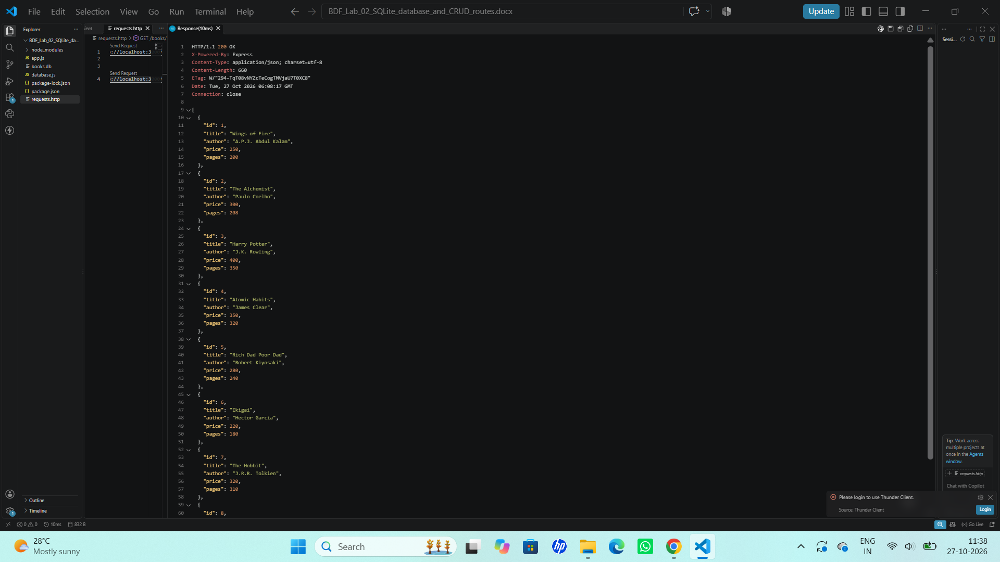
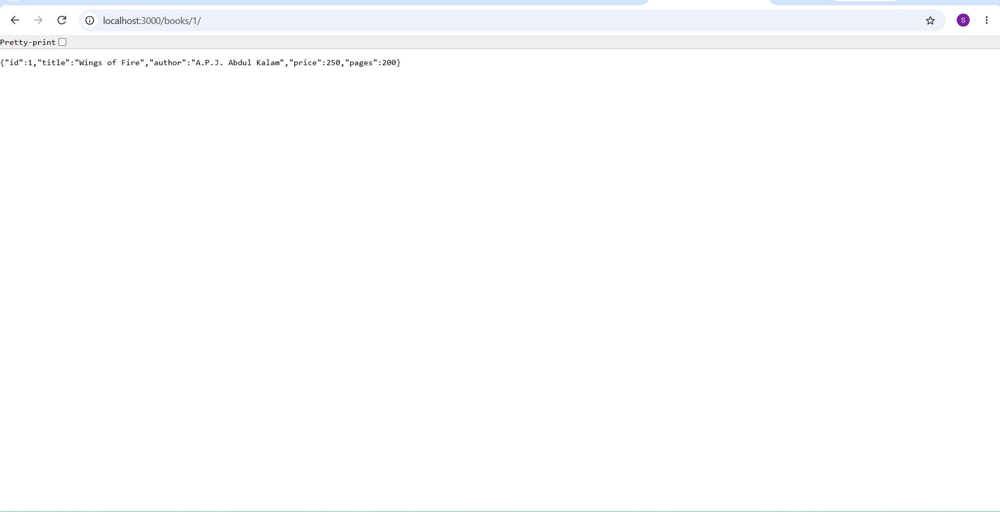
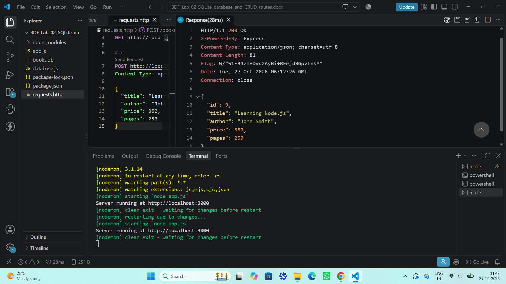
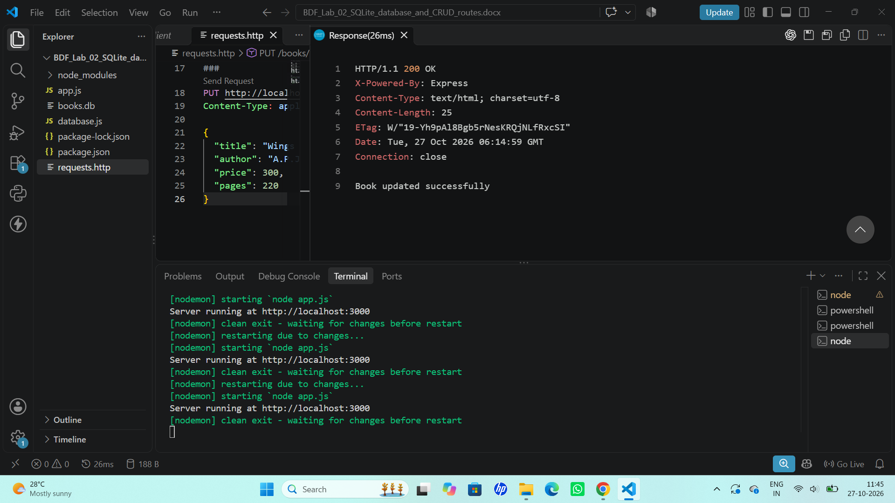
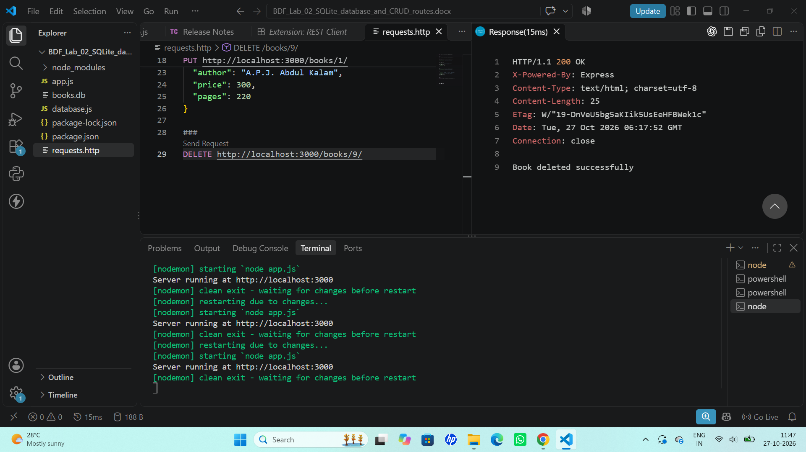

# Lab 2: SQLite Database and CRUD Routes

## Student Details
- **Name:** Konda Susvitha
- **Registration Number:252U1R9070
- **Section:** CSE GEN AI-2A

## Aim
To develop an Express.js server connected to an SQLite database and implement CRUD operations for managing books.

## Technologies Used
- Node.js
- Express.js
- SQLite
- JavaScript
- VS Code REST Client

## Project Structure
- `app.js` — Express server and CRUD API routes
- `database.js` — SQLite database connection
- `books.db` — SQLite database file
- `requests.http` — API requests for testing
- `screenshots/` — Screenshots of API responses
- `README.md` — Project documentation

## Database Details
The database contains a `book` table with the following fields:
- `id`
- `title`
- `author`
- `price`
- `pages`

The database is initialized with eight sample books.

## API Endpoints

| HTTP Method | Endpoint | Description |
|---|---|---|
| GET | `/books/` | Retrieve all books |
| GET | `/books/:bookId/` | Retrieve a book by ID |
| POST | `/books/` | Add a new book |
| PUT | `/books/:bookId/` | Update an existing book |
| DELETE | `/books/:bookId/` | Delete a book by ID |

## How to Run the Project

1. Install Node.js.
2. Open the project folder in VS Code.
3. Install the required packages:

   ```bash
   npm install
   ```

4. Start the server:

   ```bash
   node app.js
   ```

   Alternatively, run the server using Nodemon:

   ```bash
   npx nodemon app.js
   ```

5. Open the following URL in your browser to view all books:

   `http://localhost:3000/books/`

6. Use the VS Code REST Client extension and the `requests.http` file to test the CRUD endpoints.

## Screenshots

The `screenshots/` folder contains screenshots of the API responses for the five CRUD operations.

## GET ALL BOOKS


## GET BOOK BY ID


## POST BOOK


## PUT BOOK


## DELETE BOOK


## Deployment
Not deployed. The API is tested locally.

## Result
Successfully developed an Express.js REST API connected to an SQLite database to perform Create, Read, Update, and Delete (CRUD) operations on books.