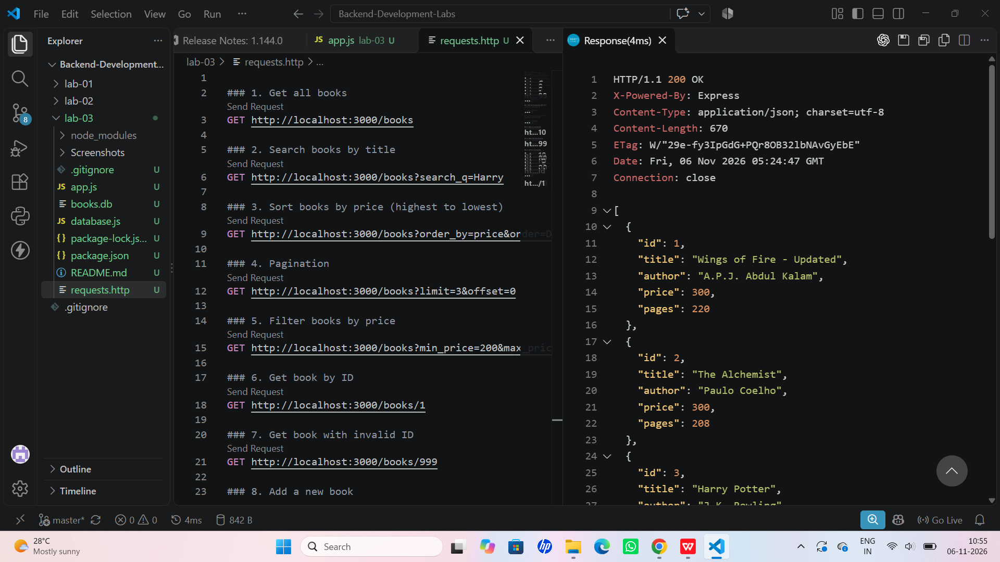
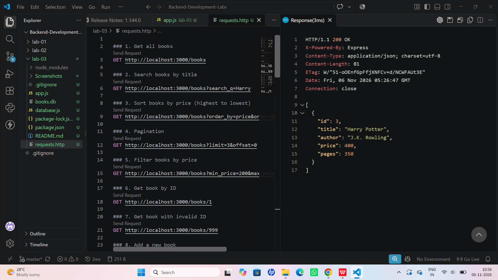
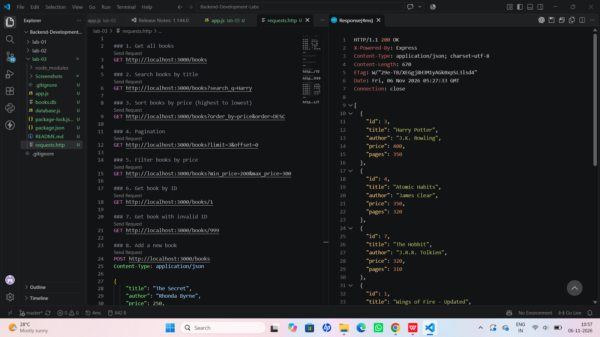
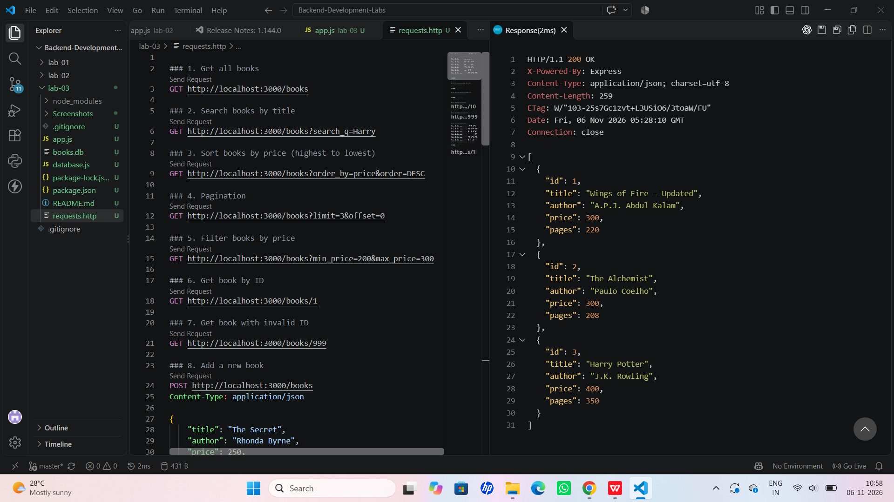
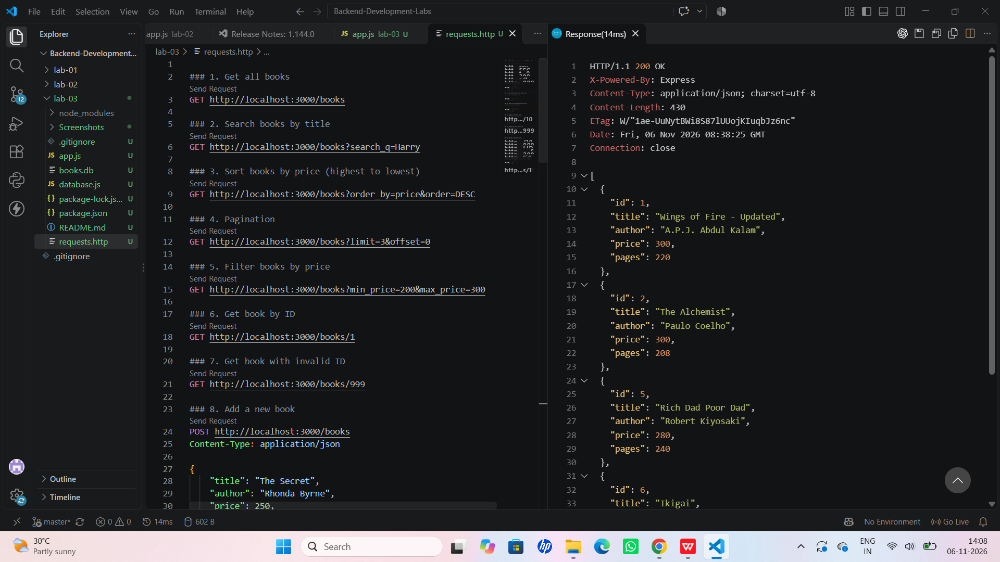
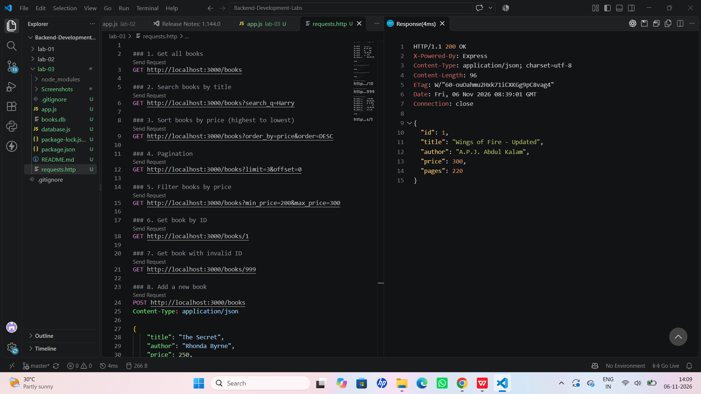
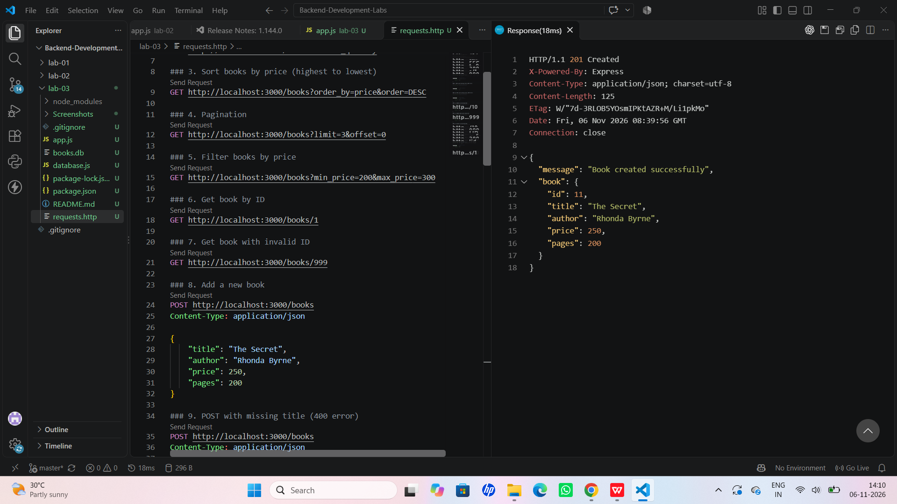
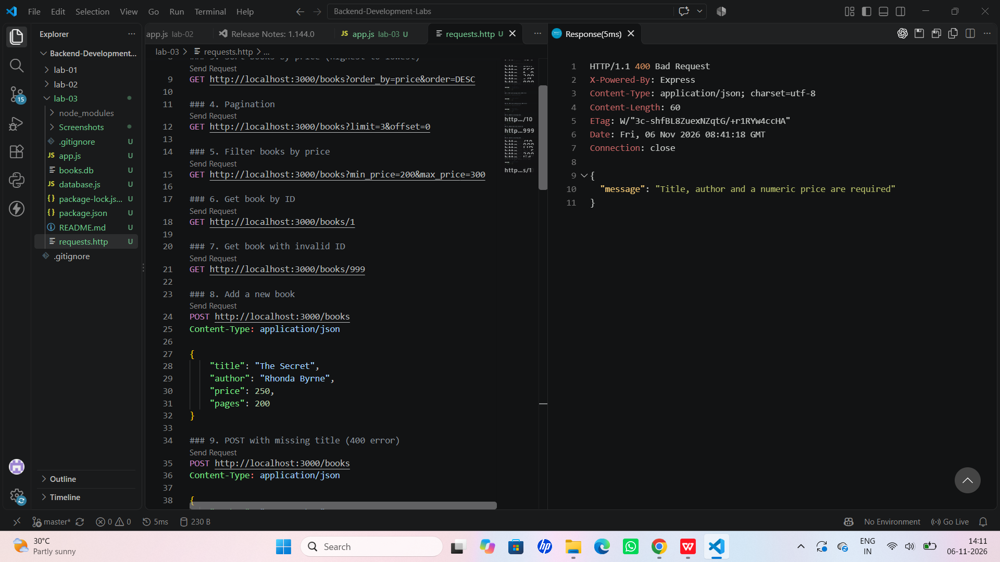
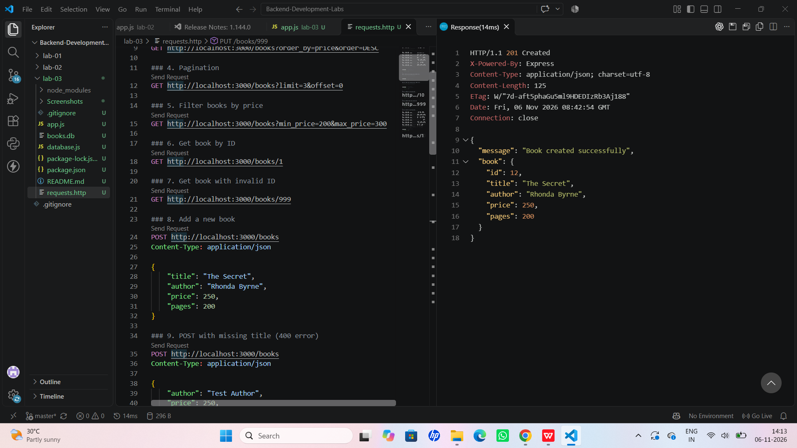
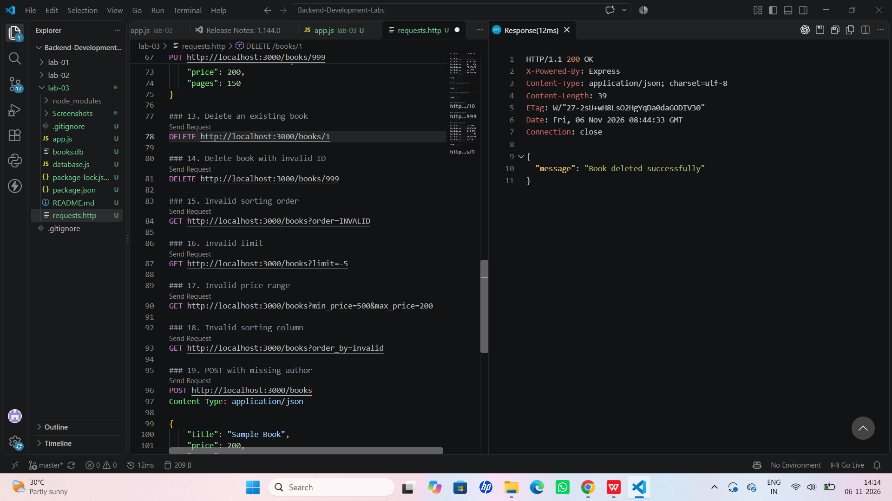

# Lab 3: REST API, Query Parameters, Validation and Debugging

## Student Details
- **Name:** Konda Susvitha
- **Registration Number:** 252U1R9070
- **Section:** CSE GEN AI-2A
- **Subject:** Backend Development Fundamentals

## Aim
To develop a RESTful Book Management API using Node.js, Express.js and SQLite, implementing query parameters, filtering, sorting, pagination, input validation and proper HTTP status codes.

## Technologies Used
- Node.js
- Express.js
- SQLite
- JavaScript
- VS Code REST Client

## Installation and Execution

1. Install dependencies:

   ```bash
   npm install
   ```

2. Start the server:

   ```bash
   npm start
   ```

3. Open the API:

   `http://localhost:3000/books`

## Environment Variables

| Variable | Description | Default |
|---|---|---|
| PORT | Server port number | 3000 |

## API Endpoints

| Method | Endpoint | Description |
|---|---|---|
| GET | `/books` | Get all books |
| GET | `/books/:bookId` | Get a book by ID |
| POST | `/books` | Add a new book |
| PUT | `/books/:bookId` | Update a book |
| DELETE | `/books/:bookId` | Delete a book |

## Query Parameters

| Parameter | Description |
|---|---|
| `search_q` | Search books by title |
| `order_by` | Sort using a column |
| `order` | Sort in ASC or DESC order |
| `limit` | Number of records to display |
| `offset` | Number of records to skip |
| `min_price` | Minimum book price |
| `max_price` | Maximum book price |

## Validation and Error Handling

- Missing title or author is rejected.
- Nonnumeric price is rejected.
- Invalid sorting order is rejected.
- Invalid sorting column is rejected.
- Invalid limit and price range are rejected.
- Missing book IDs return 404 Not Found.
- Successful creation returns 201 Created.
- Successful updates and deletions return 200 OK.
- Errors are returned in JSON format.

Example:

```json
{
  "message": "Book not found"
}
```

## Screenshots

The `screenshots/` folder contains the API testing screenshots, including:

## Screenshots

The `Screenshots/` folder contains screenshots of the API testing operations.

## GET ALL BOOKS


## SEARCH BOOKS


## SORT BOOKS


## PAGINATION


## FILTER BOOKS BY PRICE


## GET BOOK BY ID


## POST BOOK


## POST VALIDATION


## PUT BOOK


## DELETE BOOK


## Debugging Exercises

The following errors were studied:

1. **EADDRINUSE:** Occurs when the port is already in use.
2. **Wrong import path:** Occurs when a required module or file path is incorrect.
3. **Table name typo:** Occurs when the SQL query uses an incorrect table name.
4. **Missing await:** Can cause asynchronous database operations to execute before previous operations finish.

## Deployment

Platform: Render

Live URL: https://lab3-books-api.onrender.com

API Endpoint: https://lab3-books-api.onrender.com/books

## Result

Successfully developed and tested a RESTful Book Management API using Express.js and SQLite